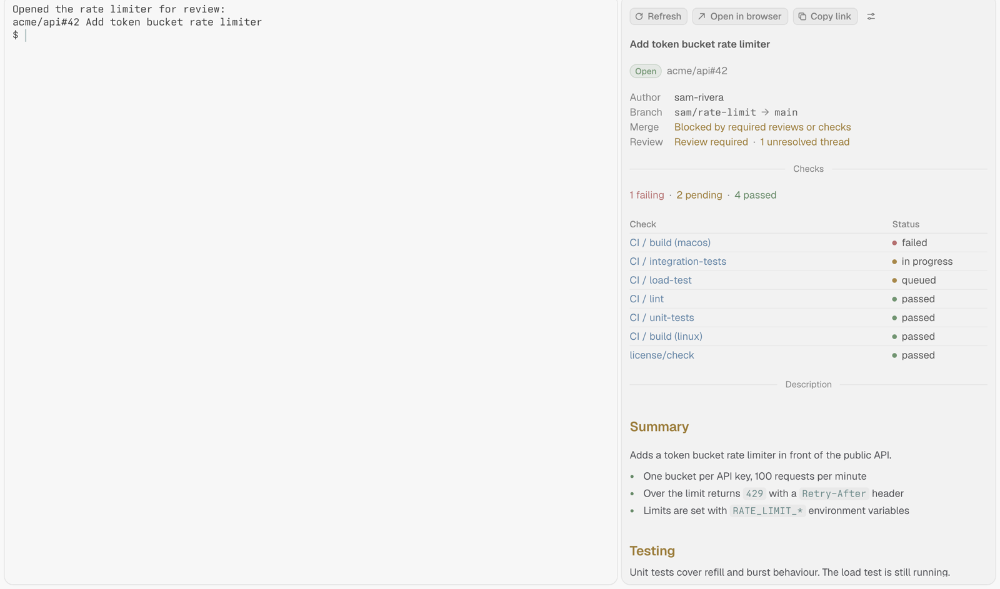

# GitHub Sidebar for Tern

Click a GitHub pull request link in a [Tern](https://tern.sh) terminal and read the PR in a native, read-only
sidebar beside the pane you clicked in: title, state, author, branches, merge state, checks, review decision,
unresolved review threads and the description rendered as Markdown. Pure Luau, no build step, no stored credentials.



Coding agents such as omp, Claude Code and Codex print Markdown links as clickable hyperlinks, so with the
[agent rule](#agent-rule) every PR they mention opens here with one click.

## Install

```sh
tern plugin install github.com/petermiles/tern-github-sidebar
```

Needs the [GitHub CLI](https://cli.github.com) (`gh`), signed in once with `gh auth login`. Without it the plugin
falls back to a Tern browser (see below).

## Use

- **Click** a link to `https://github.com/<owner>/<repo>/pull/<N>` (also `/files`, `/checks`, `?query` and
  `#fragment` forms). The sidebar opens to the right of that pane, about 38 % wide, without taking focus.
- **Click another PR link** in the same tab and the sidebar shows that PR instead of opening a second one.
- **Hold Alt** while clicking to skip the plugin and get Tern's built-in link handling.
- **Checks** link to their details pages. While any check is queued or running, the plugin runs gh's own watcher
  (`gh pr checks --watch`) and re-reads the PR as its output changes, with one final refresh when it ends; nothing
  runs once all checks have finished, and the watcher is stopped when the sidebar closes or shows another PR.
  **Refresh** reloads on demand.
- **CI status** is shown through Tern's block status, so the tab, the inbox and the Agents widget show
  `CI: 7/9 checks done` with progress while checks run, then `CI passed` or `CI failed: <first failing check>`. A
  PR without checks sets no status.
- **Open in browser** opens the page in Tern's own browser, bypassing the sidebar. **Copy link** copies the URL.
- The slider button (or the palette command **GitHub Sidebar: agent rule**) opens the [agent rule](#agent-rule) screen.

One sidebar slot exists per tab and is shared with other `*-sidebar` plugins (for example
`tern-linear-sidebar`, block kind `linear-sidebar.view`): a click replaces the other plugin's sidebar in place, and
also its fallback, a browser on a `https://linear.app/<workspace>/issue/...` page.

### When `gh` is not available

If `gh` is missing or not signed in, a click opens the PR in a Tern browser in the sidebar's place (shared browser
profile) and a toast says why, for example "gh is not signed in: run `gh auth login`". Sign in to GitHub in that
browser once and it keeps working. If `gh` is fine but cannot see the PR, the sidebar says so and offers
**Open in browser**.

## Setup

None: the plugin shells out to `gh`, which keeps its own credentials. It runs
`gh pr view <N> -R <owner>/<repo> --json ...` and one `gh api graphql` query for the review threads, so it can read
what your `gh` account can read. It finds `gh` on `PATH`, then in `/opt/homebrew/bin`, `/usr/local/bin`,
`/usr/bin`, `/home/linuxbrew/.linuxbrew/bin` and `~/.local/bin`.

## Agent rule

Terminals only make a link clickable when the agent writes it as a Markdown link. Give your agent this rule:

```text
Write every GitHub PR reference as a Markdown link: [repo#N](https://github.com/owner/repo/pull/N). When a PR's title is shown, link the title to the same URL.
```

The agent rule screen shows it with a **Copy rule** button and, for each of `~/.omp/agent/AGENTS.md`,
`~/.claude/CLAUDE.md` and `~/.codex/AGENTS.md` that exists, an **Add to** / **Remove from** button. Adding appends
the rule once between these markers (clicking again changes nothing), and removing deletes exactly that block:

```md
<!-- tern-github-sidebar-rule:start -->
...the rule...
<!-- tern-github-sidebar-rule:end -->
```

## Development

```sh
git clone https://github.com/petermiles/tern-github-sidebar
tern plugin link ./tern-github-sidebar     # use it where it is
tern plugin reload github-sidebar          # after edits; exits 1 with the error on failure
tern plugin types ./tern-github-sidebar    # writes tern.d.luau for luau-lsp (git-ignored)
```

| File | Half | Role |
| --- | --- | --- |
| `window.luau` | window | `tern.route.link`: claims PR links, picks the sidebar slot, browser fallback, palette command |
| `host.luau` | host | the `github-sidebar.view` block: state, loading, `gh` check watcher, CI status, events |
| `lib/github.luau` | both | URL parsing, locating and probing `gh`, loading a PR |
| `lib/view.luau` | host | pure view of the block state |
| `lib/rule.luau` | host | the rule text and the marked-block edits |

The block takes launch args `{url}` for a PR, or `{"rule"}` for the agent rule screen. Sending a running block the
action `goto` with a PR URL as its `value` points it at that PR (this is how the router reuses the slot).

### Trying it offline

`test/fake-gh` answers the `gh` calls the plugin makes with made-up data for one PR, `acme/api#42`: passed, failed
and pending checks, one unresolved thread and a short description. `test/instance.sh` runs it in an isolated Tern
instance (own config directory, daemon socket and `HOME`, fake `gh` first on `PATH`), so your own windows and
credentials are untouched. It does open a window of its own, so stop it as soon as you are done:

```sh
test/instance.sh start               # daemon + window, plugin linked
test/instance.sh shot out.png        # prints a link to acme/api#42, clicks it, saves a screenshot
test/instance.sh ctl palette ...     # any `tern ctl` command for the instance
test/instance.sh stop
```

`docs/screenshot.png` was taken this way. `FAKE_GH_AUTH=fail` in the environment of `start` makes the fake `gh` report
that it is signed out, to see the browser fallback.

## License

MIT
